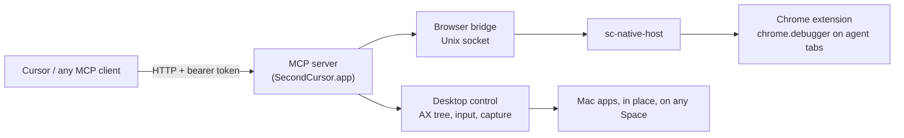

# Second Cursor

Let an AI agent use any app on your Mac while you keep working. Second Cursor clicks, types, and reads apps in the background: your cursor never moves, your focus never changes, and you are never dragged to another Space. It runs as a small menu bar app and exposes an MCP server over HTTP, so Cursor or any other MCP client can drive it.

There is one deliberate exception: local approval prompts. When an agent first touches an app you have not approved, or asks for a sensitive browser operation (your own tabs, history, clipboard, uploads), Second Cursor brings up a dialog so that you, not the model, decide. That dialog takes focus on purpose.

Version 0.2 also provides explicit client sessions, structured observations, full-text inspection, native text selection and rich paste, DOM browser actions, multi-profile browser connections, and a dependency-free JavaScript SDK. See [the client contract](docs/api.md) and [the E2E acceptance cases](docs/parity-acceptance.md).

## How it works



- **In place.** Windows stay where they are. Clicks, drags, and scrolls are synthesized and posted to the target app's process, addressed to the window, so they land even when the window is behind other apps or on a Space you are not viewing.
- **Accessibility first.** Every window is read as a compact accessibility outline with indexed elements. Clicks and typing go through accessibility actions whenever possible.
- **Diffs, not re-reads.** The first `get_window_state` of a window in a session returns the whole outline. Later reads return only the lines that changed, and an element keeps its index across reads. Pass `full: true` for the whole outline again, or `scope: <index>` to read one region at full depth.
- **Windows on other Spaces.** macOS hides off-Space windows from the normal window list, so Second Cursor finds them through the app's main/focused window or a remote-token lookup (and, for Electron apps, through their web areas).
- **Background keyboard.** Keys are posted to the target app's process. Command shortcuts (cmd+a, cmd+z, ...) briefly hand the app AppKit focus without raising it, press the matching menu item, then give focus back.
- **Parallel.** Each app gets its own serial queue, so agents working in different apps run at the same time while actions within one app stay ordered.
- **Visible presence.** While an agent works, its cursor (a black arrowhead with an orange glow) rests at its last position, with an optional caption saying what it is doing, and the menu bar icon turns orange. In Chrome the same cursor is drawn inside the agent's tab. Everything clears when the agent's turn ends (with the Cursor stop hook), when you pause, or after a minute without agent calls. A click waits until you can see the cursor land (at most half a second for long moves), and only when the cursor is on your screen.
- **Batching.** `batch` runs a predictable sequence of steps on one window as a single uninterrupted block, then returns one observation once the UI has settled, so a model spends one round trip instead of one per action. A pixel step stops the batch if the window changed size since the model last looked at it, because its coordinates would point at the old layout.
- **Browser.** A Chrome extension drives only the tabs it opens itself, in a "Second Cursor" tab group, over Chrome's debugger API. Existing user tabs are available only through local approval for discovery and claim operations; session cleanup leaves them open.
- **Optional agent display.** An invisible virtual monitor is available as a private workspace (`agent_display`, `move_to_agent_display`). It is never used unless asked for.

## Install

Requires macOS 14+ and Xcode (Swift 6).

```bash
scripts/install.sh
```

This creates a local self-signed code-signing identity (so macOS permission grants survive rebuilds), builds `SecondCursor.app`, installs it to `~/Applications`, registers the Chrome native messaging host, copies the extension to `~/Library/Application Support/SecondCursor/extension`, and launches the app.

Then:

1. Grant **Accessibility** and **Screen & System Audio Recording**. When either is missing, a small setup panel opens next to System Settings. **Open System Settings** jumps to the right pane. Drag the app icon from the panel into the list, or switch Second Cursor on if it is already listed. The panel ticks each permission off as it turns on and closes when both are granted. For Screen Recording, choose **Quit & Reopen** if System Settings asks. The menu bar's **Grant … permission** items reopen the panel, and so does `SecondCursor --show-onboarding`.
2. For browser control, open `chrome://extensions`, enable Developer mode, choose **Load unpacked**, and select `~/Library/Application Support/SecondCursor/extension`.
3. Check the setup with `SecondCursor doctor`. It reports whether the app is reachable, its version, both permissions, pause state, the extension connection, and the config path. It exits non-zero when something needs your action. Add `--json` for machine output.

`SecondCursor` in these commands is the app's binary, `~/Applications/SecondCursor.app/Contents/MacOS/SecondCursor`. `SecondCursor --help` lists every command.

## Connect a client

One command writes the entry for a client:

```bash
SecondCursor install-mcp --client cursor    # ~/.cursor/mcp.json (HTTP URL + token)
SecondCursor install-mcp --client claude    # ~/.claude.json (Claude Code)
SecondCursor install-mcp --client codex     # ~/.codex/config.toml, [mcp_servers.second_cursor]
SecondCursor install-mcp --client gemini    # ~/.gemini/settings.json
```

It only adds or replaces the `second-cursor` entry and leaves everything else in the file alone. Before it writes, it copies the original to `<file>.bak`, and it creates the file if it is missing. It prints what changed. `--dry-run` shows the entry it would write (token redacted) and which existing entries it would keep, without writing anything. Nothing is installed until you run one of these commands.

Claude Code, Codex and Gemini CLI launch a command rather than connecting over HTTP, so their entry runs `SecondCursor mcp`. That is a stdio MCP server built into the app binary. It forwards each request to the running app and starts the app if it isn't running. `node sdk/mcp-stdio.mjs` does the same for hosts where only Node is available. Any other stdio host can use `SecondCursor mcp` directly.

For Cursor, the menu bar item's **Copy Cursor MCP config** produces the same entry that `install-mcp --client cursor` writes:

```json
{
  "mcpServers": {
    "second-cursor": {
      "url": "http://127.0.0.1:8787/mcp",
      "headers": { "Authorization": "Bearer <token>" }
    }
  }
}
```

Custom hosts can use POST `/api` or `sdk/index.mjs`; all interfaces share the same dispatcher and policies.

The port and token live in `~/Library/Application Support/SecondCursor/config.json`. The server only listens on localhost and rejects requests without the token or with a non-local origin.

### Cursor turn-end hook

At the end of each agent turn, `SecondCursor --turn-ended` tells the app the turn is over. The next observation is then a full read, and approvals and claimed browser tabs held for that turn are released. `--session <id>` targets an explicit session; the default is the shared `legacy` session that MCP clients use. The command ignores its stdin and always exits 0, so a hook can never fail loudly. `install-mcp --client cursor --with-hook` adds a `stop` hook to `~/.cursor/hooks.json`, keeping your other hooks and writing a `.bak` first. `scripts/cursor-hooks.json` is the same hook as a sample to merge by hand.

### Agent skill

`.cursor/skills/second-cursor/SKILL.md` tells an agent when to use Second Cursor and how to work with it. It covers the observe-then-act loop, and writing a short Node script with `sdk/index.mjs` instead of dozens of tool calls when a flow branches. It also sets the safety rules: ask before sending, deleting or purchasing, and never read password managers. Copy it into another project's `.cursor/skills/`, or into your personal skills, to use it outside this repo.

## Tools

| Area | Tools |
| --- | --- |
| Status | `status` |
| Apps and windows | `list_apps`, `list_windows`, `launch_app`, `get_window_state`, `find_elements`, `screenshot` |
| Sessions | `session`, `bind_target`, `operation_status`, `cancel_operation` |
| Editing | `inspect_element`, `select_text`, `paste` |
| Extended browser | `browser_instances`, `browser_command` (DOM, dialogs, files, exports, screenshots, history, assets) |
| Input | `batch` (also as `act`), `click`, `drag`, `type_text`, `set_value`, `press_key`, `scroll`, `perform_action` |
| Agent display (optional) | `agent_display`, `move_to_agent_display`, `return_window` |
| Browser | `browser_status`, `browser_tabs`, `browser_open`, `browser_navigate`, `browser_snapshot`, `browser_click`, `browser_type`, `browser_press_key`, `browser_scroll`, `browser_screenshot`, `browser_close` |

## Safety

- **App approval:** the first time an agent reads or operates an app, you choose Allow for this session, Always allow, or Deny. Your own tabs, browsing history, clipboard, raw DevTools, and file uploads always ask. See [the client contract](docs/api.md#approvals).
- **Not a sandbox:** approvals limit what an agent can do through Second Cursor's tools. An agent that can also run shell commands as you could edit the config or start its own instance, so treat approvals as a guard against mistakes, not against a determined agent.
- **Pause:** the menu bar item pauses the agent; every tool except `status` is refused until you resume. `SecondCursor --pause` / `--resume` do the same from a shell.
- **Blocked apps:** `blockedBundleIDs` in `config.json` (password managers, Keychain Access, System Settings by default) can never be launched or touched.
- **Action log:** every state-changing call is appended to `~/Library/Logs/SecondCursor/actions.jsonl` before it runs.
- **Timeouts:** execution deadlines are capped at 60 s. A timeout does not cancel already dispatched input; use operation IDs to reconcile outcomes and cancel queued work.
- **Quitting** returns any window on the agent display to where it came from, then removes the display.

## Testing

Testing is end to end only. Every suite runs against a disposable test instance, not against your running app. The harness starts a fresh copy of the installed bundle with its own `SC_HOME` folder, port, token and config, and stops it afterwards. Your app, config, logs and pause flag are never read, written or restarted. Test instances never show approval dialogs or the setup panel.

```bash
python3 e2e/run.py            # or name scenarios: python3 e2e/run.py textedit_background calculator
python3 e2e/parity.py         # sessions, editing, browser
python3 e2e/review.py         # review regressions (--short-retention for lease/retention expiry)
python3 e2e/setup.py          # mcp stdio proxy, doctor, --turn-ended, install-mcp, onboarding gating
python3 e2e/policy.py         # approvals in deny mode (no UI), turn end, action log
python3 e2e/instance.py       # test-instance isolation
python3 e2e/focus.py          # focus safety; puts a probe window in front and takes focus while it runs
python3 e2e/cursor.py         # arrow and menu-bar presence; also takes over the screen while it runs
python3 e2e/latency.py        # per-call timings, written to latency.json
python3 e2e/find.py           # find_elements, act, the compact tool surface
```

`SC_E2E_APP=build/SecondCursor.app` tests another bundle, and `--installed` targets your running app instead (opt-in). `python3 e2e/setup.py` runs `install-mcp` against a temporary `HOME` and checks that your real client configs are unchanged.

`python3 e2e/agent_smoke.py --run` checks that a real model can use the tools. It has the Cursor Agent CLI compute 7 × 6 in Calculator and append the result to a TextEdit window, through a project-level MCP config that points at a test instance, then verifies the result independently. The fixture windows open on the agent display, off your screen. Each report splits the agent loop into model time and tool time. `--models gemini-3.8-flash-medium,composer-2.5-fast --repeat 3` compares models and writes `e2e/artifacts/agent-compare-<ts>.md`. It spends model usage, so without `--run` it only prints what it would do.

The suite talks to the app over MCP like a real client and, around every scenario, independently checks that your cursor, frontmost app, and active Space did not change. Each run writes a report, screenshots, and a full call transcript to `e2e/artifacts/<run-id>/`. Scenarios that depend on your environment (an Electron app open, a window on another Space, the Chrome extension loaded) are skipped with a reason when unavailable.

## Development

| Target | Purpose |
| --- | --- |
| `SCCore` | Desktop control: window discovery, accessibility tree, input, capture |
| `SCDisplay` / `SCDisplayPrivate` | Agent display (CGVirtualDisplay), window hosting, cursor clamp |
| `SCServer` | MCP server over HTTP, tool catalog, gates, action log |
| `SCBrowser` / `sc-native-host` / `extension/` | Browser bridge, native messaging host, Chrome extension |
| `SecondCursor` | Menu bar app that wires everything together |
| `sc-dev`, `sc-display-dev`, `sc-browser-dev` | Command-line tools for exercising each module against real windows |

`spikes/` holds the original research prototypes.

## Limitations

- Relies on private macOS APIs (SkyLight event posting, remote accessibility tokens, CGVirtualDisplay). A macOS update can break any of them, and the app cannot ship through the Mac App Store.
- Modifier-clicks (shift-click, cmd-click) are not supported yet: the modifier does not reach the app through process-targeted events.
- Canvas-style apps and games that only accept hardware events, drag-and-drop between apps, and hover-only UI are not supported.
- Custom-drawn apps (Ableton, games) may stop repainting while on a Space you are not viewing, so their screenshots go stale; input still lands and the accessibility tree stays live.
- A window on another Space that neither its app nor any accessibility client has exposed yet cannot be reached until the app is touched once.
- Chrome shows its "started debugging this browser" bar while the extension is attached to an agent tab.
- A pixel click or drag into a background window of the app you are currently using can bring that window forward, because the app is already active. Element-index actions don't have this problem.

## Credits

The background input recipes (SkyLight event posting, focus without raise) build on [cua-driver](https://github.com/trycua/cua) (MIT, see `LICENSES/cua-driver-MIT.txt`) and ideas from [yabai](https://github.com/koekeishiya/yabai).
