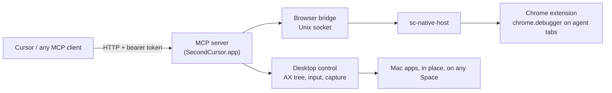

# Second Cursor

Let an AI agent use any app on your Mac while you keep working. Second Cursor clicks, types, and reads apps in the background: your cursor never moves, your focus never changes, and you are never dragged to another Space. It runs as a small menu bar app and exposes an MCP server over HTTP, so Cursor or any other MCP client can drive it.

## How it works



- **In place.** Windows stay where they are. Clicks, drags, and scrolls are synthesized and posted to the target app's process, addressed to the window, so they land even when the window is behind other apps or on a Space you are not viewing.
- **Accessibility first.** Every window is read as a compact accessibility outline with indexed elements. Clicks and typing go through accessibility actions whenever possible.
- **Diffs, not re-reads.** The first `get_window_state` of a window returns the whole outline. Later reads return only the lines that changed, and an element keeps its index across reads. Pass `full: true` for the whole outline again, or `scope: <index>` to read one region at full depth.
- **Windows on other Spaces.** macOS hides off-Space windows from the normal window list, so Second Cursor finds them through the app's main/focused window or a remote-token lookup (and, for Electron apps, through their web areas).
- **Background keyboard.** Keys are posted to the target app's process. Command shortcuts (cmd+a, cmd+z, ...) briefly hand the app AppKit focus without raising it, press the matching menu item, then give focus back.
- **Parallel.** Each app gets its own serial queue, so agents working in different apps run at the same time while actions within one app stay ordered.
- **Batching.** `batch` runs a predictable sequence of steps on one window as a single uninterrupted block, then returns one observation once the UI has settled, so a model spends one round trip instead of one per action. A pixel step stops the batch if the window changed size since the model last looked at it, because its coordinates would point at the old layout.
- **Browser.** A Chrome extension drives only the tabs it opens itself, in a "Second Cursor" tab group, over Chrome's debugger API. Your own tabs are never listed or touched.
- **Optional agent display.** An invisible virtual monitor is available as a private workspace (`agent_display`, `move_to_agent_display`). It is never used unless asked for.

## Install

Requires macOS 14+ and Xcode (Swift 6).

```bash
scripts/install.sh
```

This creates a local self-signed code-signing identity (so macOS permission grants survive rebuilds), builds `SecondCursor.app`, installs it to `~/Applications`, registers the Chrome native messaging host, copies the extension to `~/Library/Application Support/SecondCursor/extension`, and launches the app.

Then:

1. Grant **Accessibility** and **Screen & System Audio Recording** to Second Cursor in System Settings > Privacy & Security, and relaunch it.
2. For browser control, open `chrome://extensions`, enable Developer mode, choose **Load unpacked**, and select `~/Library/Application Support/SecondCursor/extension`.

## Connect a client

The menu bar item has **Copy Cursor MCP config**. It produces an entry like this for `~/.cursor/mcp.json`:

```json
{
  "mcpServers": {
    "second-cursor": {
      "url": "http://127.0.0.1:8787/mcp",
      "headers": { "Authorization": "Bearer <token>" }
    }
  }
}
```

The port and token live in `~/Library/Application Support/SecondCursor/config.json`. The server only listens on localhost and rejects requests without the token or with a non-local origin.

## Tools

| Area | Tools |
| --- | --- |
| Status | `status` |
| Apps and windows | `list_apps`, `list_windows`, `launch_app`, `get_window_state`, `screenshot` |
| Input | `batch`, `click`, `drag`, `type_text`, `set_value`, `press_key`, `scroll`, `perform_action` |
| Agent display (optional) | `agent_display`, `move_to_agent_display`, `return_window` |
| Browser | `browser_status`, `browser_tabs`, `browser_open`, `browser_navigate`, `browser_snapshot`, `browser_click`, `browser_type`, `browser_press_key`, `browser_scroll`, `browser_screenshot`, `browser_close` |

## Safety

- **Pause:** the menu bar item pauses the agent; every tool except `status` is refused until you resume. `SecondCursor --pause` / `--resume` do the same from a shell.
- **Blocked apps:** `blockedBundleIDs` in `config.json` (password managers, Keychain Access, System Settings by default) can never be launched or touched.
- **Action log:** every state-changing call is appended to `~/Library/Logs/SecondCursor/actions.jsonl` before it runs.
- **Timeouts:** every tool call answers within 60 s, so a hung app cannot stall the client.
- **Quitting** returns any window on the agent display to where it came from, then removes the display.

## Testing

Testing is end to end only. With the app installed and running:

```bash
python3 e2e/run.py            # or name scenarios: python3 e2e/run.py textedit_background calculator
```

The suite talks to the app over MCP like a real client and, around every scenario, independently checks that your cursor, frontmost app, and active Space did not change. Each run writes a report, screenshots, and a full call transcript to `e2e/artifacts/<run-id>/`. Scenarios that depend on your environment (an Electron app open, a window on another Space, the Chrome extension loaded) are skipped with a reason when unavailable.

## Development

| Target | Purpose |
| --- | --- |
| `SCCore` | Desktop control: window discovery, accessibility tree, input, capture |
| `SCDisplay` / `SCDisplayPrivate` | Agent display (CGVirtualDisplay), window hosting, cursor clamp |
| `SCServer` | MCP server over HTTP, tool catalog, gates, action log |
| `SCBrowser` / `sc-native-host` / `extension/` | Browser bridge, native messaging host, Chrome extension |
| `SecondCursor` | Menu bar app that wires everything together |
| `sc-dev`, `sc-display-dev`, `sc-browser-dev` | Command-line tools for exercising each module against real windows |

`spikes/` holds the original research prototypes.

## Limitations

- Relies on private macOS APIs (SkyLight event posting, remote accessibility tokens, CGVirtualDisplay). A macOS update can break any of them, and the app cannot ship through the Mac App Store.
- Modifier-clicks (shift-click, cmd-click) are not supported yet: the modifier does not reach the app through process-targeted events.
- Canvas-style apps and games that only accept hardware events, drag-and-drop between apps, and hover-only UI are not supported.
- Custom-drawn apps (Ableton, games) may stop repainting while on a Space you are not viewing, so their screenshots go stale; input still lands and the accessibility tree stays live.
- A window on another Space that neither its app nor any accessibility client has exposed yet cannot be reached until the app is touched once.
- Chrome shows its "started debugging this browser" bar while the extension is attached to an agent tab.

## Credits

The background input recipes (SkyLight event posting, focus without raise) build on [cua-driver](https://github.com/trycua/cua) (MIT, see `LICENSES/cua-driver-MIT.txt`) and ideas from [yabai](https://github.com/koekeishiya/yabai).
